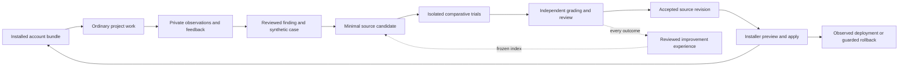

# Account observation and improvement loop

Status: original design for [issue #9](https://github.com/hwanjjang/agent-dotfiles/issues/9),
2026-10-17, source baseline `ed1da03`; implementation status updated 2026-10-18.
The [store and manual CLI](../../account/observation/README.md) support synthetic
observations, explicit task feedback and reviewed synthetic development-case export.
Opt-in [Claude and Codex adapters](../../account/observation/native.md) and installer
registration exist with separate consent, native-trust and platform boundaries.
The [capacity guide](../../account/observation/capacity.md) records the qualified
10,000-callback synthetic PostToolUse workload on one reference host; mixed-workload
latency and other environments remain unqualified. Offline evaluation accounting
and [source-review recommendation consumers](promotion-recommendations.md) are implemented,
including committed-source verification and selected same-host receipts. The
[frozen native-trial runner](../native-trials.md) has selected source-bound
historical credential-free and authenticated qualification.
[Trusted offline artifact admission](evaluation-accounting.md#admit-recorded-native-artifact-snapshots)
and [serial launch reservations](evaluation-accounting.md#serial-native-launch-reservations)
are implemented; current-source authenticated admission and actual comparisons remain pending. Automated diagnosis,
authenticated comparative trials, operational promotion and automatic delivery
remain unqualified or planned. No persistent real-account collection or scheduled
work was activated by this implementation.

## Problem and intended experience

The account installer identifies the shared configuration it delivered, but cannot
show whether that configuration helped an actual task. We need a traceable path
from ordinary work to a tested source change, including improvements that remove
instructions or replace them with deterministic checks.

After opting selected projects into collection, the user keeps using the native
client. Lightweight hooks record observable events locally. The user can attach
feedback to a task; a maintainer periodically initiates analysis, reviews a
reproduction and candidate change, and runs a controlled comparison. Accepted
source changes reach the account through the existing installer.



Collection can run automatically after setup. Analysis and paid evaluation start
manually in the first version. The observation runtime does not modify skills,
merge changes, install accounts or create its own scheduler.

## Navigate the cycle in AK SDLC

The [AK SDLC map](../map/workflow.html#skill-improvement-eval) exposes the cycle
under Anytime > Self-improvement & eval (1-6). Its numbered nodes are a guide to
this design, not additional state-machine stages or installed capabilities.

| Step | Present capability and boundary |
| --- | --- |
| 1. Observe | Synthetic store/CLI and opt-in Claude/Codex hook delivery exist; consent, native trust and source-bound platform limits remain explicit. |
| 2. Reproduce | Explicit task binding, feedback and reviewed synthetic case export are implemented; evidence-bound caller triage is implemented; automated diagnosis remains planned. |
| 3. Candidate | Existing investigation/authoring/TDD methods can prepare a manual candidate; loop orchestration is planned. |
| 4. Eval | Reviewed exports feed frozen offline comparisons, calibrated deterministic checks and complete paired accounting. The separate native runner retains historical selected-profile qualification; [offline artifact admission](evaluation-accounting.md#admit-recorded-native-artifact-snapshots) and [serial reservations](evaluation-accounting.md#serial-native-launch-reservations) are implemented; current authenticated admission, comparisons and same-host held-out evaluation remain pending. |
| 5. Review | [Native source review and the selected same-host verifier](promotion-recommendations.md) are implemented. Actual qualifying comparison evidence remains pending; independent source review and account authority remain separate. |
| 6. Deploy | Existing committed-revision installer and rollback apply; automatic eval-to-deployment integration is planned. Return to observation of the delivered identity. |

The ordinary PR route remains authoritative for authorized source work. Evaluation
compares candidate behavior; it does not replace correctness tests, review, source
acceptance or account activation boundaries.

## Existing boundaries and client evidence

| Boundary | Observed source or documentation | Design consequence |
| --- | --- | --- |
| Delivery | [source_snapshot and receipt handling](../../scripts/setup_account.py) resolve a committed bundle and retain revision/asset fingerprints. | Reuse that identity; do not build another installer. |
| Account mutation | [account_storage.py](../../scripts/account_storage.py) owns journals, conflicts and guarded rollback. | Observation reads a limited receipt view; only the installer changes delivered configuration. |
| Hooks | [planning dispatcher](../../account/hooks/planning-hook.py) has a finite planning route allowlist. | Keep the separate observation dispatcher independent; planning recovery does not collect telemetry. |
| Current verification | [client verification](../client-verification.md) distinguishes installation, discovery and behavior. | A clean receipt is neither effective-context evidence nor task success. |
| Codex documentation | [Hooks](https://learn.chatgpt.com/docs/hooks) expose lifecycle identities, optional transcript paths and event-specific fields. Transcript format is unstable; subagent hooks can share the parent's session ID. | Version adapters and qualify child/turn identity. Never infer actor identity from session ID alone. |
| Codex runner | [Non-interactive mode](https://learn.chatgpt.com/docs/non-interactive-mode) documents JSONL events. Local `codex exec --help` confirms the command surface on 0.159.2. | A possible trial/export adapter; complete event coverage and isolation still need execution checks. |
| Claude documentation | [Hooks](https://code.claude.com/docs/en/hooks) distinguish response completion, interruption and failures. A Stop payload can contain a newer final message than the transcript. | Stop is a response boundary, not task completion; capture completeness is explicit. |

Claude observation was qualified with synthetic work on client 2.1.302 and actual
Haiku 5.5, using disposable installer-generated settings and existing authentication.
See the [native guide](../../account/observation/native.md) for tested callbacks and
limits. Codex collection has separately qualified source-bound results in that guide;
Hermes observation remains unsupported. Missing fields and unqualified platforms
stay unknown rather than silently substituting another event or client.

## Selected architecture and alternatives

Use **native hooks with a private event ledger** as the primary observation path.
Hooks normalize and durably write a small allowlisted record, then return the
client's qualified neutral response. They do not invoke models, parse entire
transcripts or wait for analysis. The ledger is independent of planning state.

Three independently authored alternatives were compared:

| Alternative | What it hides from callers | Selection |
| --- | --- | --- |
| Native hooks and immutable per-event records | Normalization, concurrent writes and ordinary-session capture after opt-in | Base: fits existing native account usage without replacing the launcher. |
| Host/wrapper-owned structured streams | Strong launch identity and stream capture for managed executions | Use for controlled trials and optional explicit exports. Requiring it for ordinary work would leave other launches unobserved. |
| Bounded post-run import with manifests/cursors | Transcript formats, incremental recovery and authorized source bounds | Use as an explicit evidence-enrichment path. Sole reliance on import would miss contemporaneous configuration identity without launch instrumentation. |

Keep one normalized ledger contract. Each run declares an authoritative source
per event class; enrichment adds provenance/evidence references rather than
counting the same tool call twice. Native IDs allow exact deduplication. Without
such IDs, preserve possibly repeated actions with an ambiguity marker rather
than merging by identical text or timestamp.

The design accepts incomplete coverage and adapter maintenance in exchange for
low collection overhead and native usage. A central telemetry service, vector
database and replacement agent host are unnecessary for the first version.
Filesystem records cost inodes; a rebuildable index supports reads without making
hooks coordinate a shared append stream.

An independent read-only reviewer selected the native-hook candidate. The synthesis
adds precise grant/import/deletion boundaries from the import candidate and the
frozen experiment recipe from the wrapper candidate. Three candidate artifacts
were completed using Codex and Hermes; an unavailable Claude seat was replaced
by a fresh Codex worker. This was independent design comparison, not a benchmark
or a three-model-family consensus.

## Usage and ownership interfaces

These are proposed interface sketches, not installed commands. One account setup
selects projects, capture fields and retention; it is not a per-session prompt.

```python
# Native adapter after account/project opt-in; no model call.
capture.from_hook(registration_id, bounded_payload)  # Receipt | CaptureGap

# Explicit feedback links selected session/actor/turn ranges to a task.
task_id = observations.bind(project_id, selected_ranges, existing_task_id=None)
finding_id = improvement.triage(task_id, feedback, approved_evidence)

# Manual experiment kickoff against a reviewed synthetic reproduction.
report = evaluation.compare(reviewed_case_set, current_snapshot,
                            candidate_snapshot, frozen_experiment)
```

`from_hook` validates the minimal envelope and grant before parsing allowed
content; it owns normalization, the final epoch check and durable persistence.

| Owner | Proposed source location | Exclusive responsibility |
| --- | --- | --- |
| Capture boundary | `account/observation/` | Client adapters, consent validation, neutral hook response, private event persistence and capability/health checks |
| Observation store | `account/observation/` | Immutable records/manifests, task links, feedback, bounded-import cursors, retention and derived index |
| Improvement workflow | `scripts/improvement/` | Manual evidence selection, finding classification, synthetic case preparation and candidate provenance |
| Evaluation runner | `scripts/improvement/` | Frozen experiment plan, isolated trials, artifacts, budgets and comparison report |
| Evaluator owner | Maintained checks plus same-host held-out cases | Grading contracts, qualification and promotion recommendation; the updater must not change these during an experiment; frozen identities detect drift |
| Existing installer | `scripts/setup_account.py`, `scripts/account_storage.py` | Runtime delivery, selected hook registration, source revision, transaction recovery and rollback |

The observation library and synthetic maintenance CLI occupy the first two
locations, including immutable task selections and explicit feedback. The manual
case CLI prepares caller-supplied synthetic inputs and requires exact-digest review
before export. Caller-declared categories are checked against selected evidence;
only instruction cases qualify, and outcome cases require an actual failed tool.
This is reported attribution, not verified diagnosis. The in-tree evaluator consumes
reviewed public exports for offline development accounting. Automated diagnosis
and comparative model execution remain unimplemented. The installer includes
`account/` source but excludes `scripts/` from its bundle; maintenance CLIs run
from the checkout. A later installer change must explicitly own any new observation entry
point and opt-in registration, preserving other hooks. Observation data is never
an installer-managed asset or part of its rollback payload.

## Records and identity

| Record | Minimum contract |
| --- | --- |
| Capture grant | Exact canonical project/worktree roots, client/profile, adapter/schema identity, allowed fields, retention/expiry, processing budgets, epoch, explicit source/time/byte bounds for imports |
| Environment manifest | Delivered commit and receipt digest, component/dependency fingerprints, drift status, client/adapter versions, observed model/settings and known coverage |
| Observation | Stable local ID, grant epoch, source identity/sequence if supplied, project/profile, session, actor/parent, turn/tool-call IDs if known, event kind, time, manifest reference, evidence references and gaps |
| Task | User goal linked to explicit actor/turn ranges across sessions; no account-global current task |
| Feedback/finding | Author/source, selected task/events, symptom, evidence, contrary examples, suspected cause and confidence; feedback is an observation, not a verified diagnosis |
| Reviewed case | Synthetic prompt/input fixture, observable outcome contract, development/holdout class, artifact hashes and private lineage reference |
| Candidate | Baseline tree hash, minimal patch, resulting tree hash, changed components/dependency closure, hypothesis, case IDs and the frozen experience index digest |
| Trial/comparison | Frozen experiment hash, exact arm/run identity, actual environment manifest, artifacts, independent grades, missing evidence, costs and verdict |
| Improvement experience | Referenced finding, case, candidate and comparison identities; per-component edit rows and verdicts; one lesson or `NO_ENTRY`; review status, applicability and exposure class. See [Learn from earlier attempts](#learn-from-earlier-attempts) |
| Deployment observation | Accepted source identity, installer transaction reference, delivered hashes, qualification result and any rollback reference |

Unknown values carry a reason; they are not empty strings or inferred successes.
Installation, discovery, reading and invocation are separate exposure observations.
Task outcome has separate evidence-backed assertions and user acceptance signals.
An exit code describes a command, not necessarily the task's correctness.

Namespace native IDs by client/profile/project. Children require observed actor
identity; unattributable child/tool events stay unresolved. If native turn IDs are
missing, use explicitly synthetic intervals and report weaker correlation.
Stop seals a response interval. Task completion requires explicit feedback or an
outcome check. Resume does not merge tasks by similar wording; cross-project links
require explicit selections from independently opted-in roots.

The store owns manifest probes with capture time, source fingerprints and the
specific boundary they describe. A cached probe describes its original observation,
not continuous validity. At each qualified session/turn boundary, refresh the
bounded snapshot; receipt changes invalidate cached delivery metadata. Missing or
over-budget probes record a gap instead of reusing stale data as current.
Receipt identity records delivery only. Project
overrides, duplicate skills, stale manifests and mid-turn edits make effective
exposure partial or unknown. A historical import cannot borrow today's receipt
to claim yesterday's version. Matching start/end hashes cannot exclude an
intervening change. Controlled comparisons use immutable bundles and
qualified isolation to establish stronger attribution than field observations.

## Capture, storage and recovery

Before parsing beyond a minimal routing envelope, verify the active grant and
its exact scope. Adapter/client identity comes from the trusted registration,
not solely from payload claims. Disabled collection performs no evidence writes,
body/transcript reads or remote calls. Native-ID deduplication uses the complete
project/client/profile/session/source namespace.

After setup, allowlisted hook metadata includes event identity, tool category,
terminal status when actually supplied, duration/usage when known, and component
references when identifiable. Merely receiving a post-tool callback is not proof
of success. Background tools remain pending until terminal evidence arrives.
Default metadata collection discards prompts, arguments, outputs, assistant text,
environment values and transcript bodies in memory. An optional project evidence
grant can retain bounded selected fields; it does not permit arbitrary file reads.

The proposed private root is `.agents/agent-dotfiles/observations/`, relative to
the selected account home, separate from `bundle/` and installer `state/`.
Directories use 0700 and files 0600. Local project aliases resolve to private
canonical roots; these mappings never enter published reports. Reject symlink
escapes and unrecognized sources. No recursive account-history scan is allowed.

Each invocation writes its own bounded event file: temporary write, file sync,
atomic rename and directory sync. Only durable records receive acknowledgments.
Readers ignore unfinished temporary files. A single store owner builds a
rebuildable SQLite index; task links and feedback are durable records too.
Stable source IDs deduplicate retries. A callback without a stable identity gets
a unique record and explicit possible-duplicate coverage.

Explicit import accepts exact files or a qualified project-filtered discovery
source. It validates grant epoch, file identity/generation, adapter version and
bounded byte ranges. Import only complete records; atomically persist a batch and
its next cursor as one immutable batch record before advancing the derived index.
Replaying that batch is idempotent. Truncation/rotation creates a generation;
boundary mismatch or unknown schema stops at the last committed position and
quarantines the remainder. Identical text is never an event identity.

Grant revocation and purge take an exclusive project guard; capture/import hold
a short shared guard while checking the epoch and committing. Stale queued work
cannot publish after revocation. Disk-full or malformed input returns a neutral
hook response and a payload-free diagnostic; no model continuation or blocking
decision is emitted. Health reports include lag, rejected events and gaps.
Completely missed hook deliveries remain unknowable, so observed failure rates
must name their coverage and denominator.

Proposed defaults: 30 days for metadata and seven days for approved excerpts,
with bounded explicit retention holds for selected experiments. Deletion removes
owned records, attachments, private lineage and derived indexes, and retains
minimal non-content tombstones/cursor bounds to prevent reimport. Grants and
private identity mappings are removed when their project is forgotten. Rebuilds
and copied-spool ingestion honor tombstones. Regranting starts at current source
high-water marks with a new epoch; it cannot automatically replay deleted history.
Reviewed synthetic cases may survive only with private lineage severed and all
private excerpts/derivatives removed. Native client originals and external backups have different
owners; no forensic-erasure claim is made.

Collection performs no network transfer. Local storage does not imply local model
inference: triage/judging through a remote provider can transmit its inputs.
Only reviewed synthetic cases or explicitly approved bounded evidence may be
submitted. Outbound authorization binds approved input-manifest hashes, allowed
derived fields/artifacts, provider/model destination and time/token budget.
It also names the purpose: triage, trial execution or model judging. A manual
kickoff can approve these displayed bounds once; calls within the grant do not
require repeated confirmation. Model-judge credentials and egress are included
in isolation qualification.
Changing those inputs or destination requires a new authorization; collection
consent is never reused as inference authority. Check the grant before each
submission and stop when its budget expires. Public export is a separate sanitized artifact; neither automatic
redaction nor `.gitignore` establishes publication safety.

### Slice 1 qualification boundary

The first implementation uses an exclusive **store-wide** guard instead of shared
project guards. This serializes mutations, revocation and cache rebuilds for a
small bounded synthetic ledger. Finer concurrency and native hook latency require
slice 2 qualification. Scope is one exact project/profile/source registration;
forgetting a project requires revoking each of its registrations. The current
adapter accepts explicitly supplied synthetic JSON/JSONL only, with caller-owned
source generations and high-water marks, not native history discovery.

Grants expire together within 30 days and manual `prune` removes their records;
rolling per-record retention, excerpt grants, holds and background cleanup remain
future work. Events carry an unknown manifest; no account probe, attribution or
model inference is implied. The implemented API and CLI in the linked guide are
a narrower runnable surface than the future interface sketches above.

The subsequent [native capacity/attribution slice](../../account/observation/capacity.md)
adds durable sequence reservations and bounded session/response-boundary delivery
snapshots. Its 10,000 installed-callback subprocess run qualifies synthetic
capacity/recovery on the recorded host; the capacity guide records the final
p95 result and distinguishes earlier measurements. The PostToolUse-only workload
excludes boundary probes and does not establish mixed-workload latency. Receipt identity still does not establish effective model exposure.

## From a recorded failure to a candidate

Consider a task where a test command fails to start but the assistant reports
that verification passed. A tool-failure event alone supports a suspicion. The
claim text or an explicit user correction is needed to establish the mismatch.
If absent, classify the finding as insufficient evidence and request a selected
attachment or synthetic reproduction.

Manual triage distinguishes instruction/routing defects, task misunderstandings,
tool/configuration defects, environment/authentication failures and unknowns.
Keep successful and contrary examples; failure-only samples cannot establish an
account-wide regression rate. Prefer a script/check for a mechanical defect.

The case owner creates a tiny project where the verification command is unavailable,
plus a normal successful-verification counterpart. The contract requires accurate
reporting of observed coverage. A reviewed synthetic case retains the failure
mechanism without private project names, code or session content. Private lineage
connects it to the observation but is not published with the case.

The updater receives development cases and proposes one minimal change against
an immutable baseline. It may edit a skill, policy, MCP template or deterministic
check; the hypothesis names which behavior should improve. It must not rewrite the
grading contract or install the candidate on the live account. Held-out answers are
not supplied to its author context; this is procedural separation with recorded
exposure, not enforced denial of the same-account author's filesystem access.

### Learn from earlier attempts

An **improvement experience** records what one candidate attempt showed, so a later
author can start from evidence instead of repeating the attempt. It interprets
existing trial results and never replaces their grades or the comparison decision.
Record one for every candidate attempt, including rejected and inconclusive ones.
A missing lesson is an acceptable result.

**Edit rows.** Write one row per changed component:

- the component;
- what changed;
- the observed behavioral difference, with references to the run or trajectory point;
- one verdict: `helped`, `hurt`, `no observed effect` or `confounded`.

Prefer `confounded` when several components changed together. Also prefer it when
a single repetition carries the difference. Selection, adoption or rejection alone
does not show which edit caused a result. An edit in a rejected candidate may still
have helped.

Diff cumulative effects against the original baseline tree. For a sequence of
candidates, also diff against the parent.

**Lesson.** Write at most one lesson, and only when the edit rows support it:

- `cue`: the shape of situation where it applies;
- `lesson`: an operation that names the component and can be applied and checked;
- `evidence`: the supporting rows;
- `confidence`.

Otherwise record `NO_ENTRY`. Label workspace facts separately from procedures.
Treat a reused fact as a hypothesis and re-verify it within the existing evidence
grant. Keep task-specific facts out of shared guidance.

**Review and retrieval.** Entries move through draft → reviewed → reusable →
superseded. A maintainer reviews an entry when it is admitted or revised; reading
an entry needs no further approval.

Before authoring, freeze an index of reusable entries from earlier cycles, and
record its digest with the candidate. The author reads the index first and opens
only relevant entries. The index excludes:

- stale, unreviewed or incompatible entries;
- material derived from held-out cases;
- hints derived from grades.

Later exposure follows the held-out reclassification rules below.

**Storage.** Canonical records, attempt history and retrieval state stay private,
under the observation store's ownership. That store does not yet accept this
record kind; see [#81](https://github.com/hwanjjang/agent-dotfiles/issues/81).
Publish only sanitized examples that are understandable on their own, through a
reviewed PR under `docs/evidence/`. The first is the
[development pilot example](../evidence/improvement-experience-pilot-2026-10-19.md).
A lesson supports a hypothesis. It never authorizes promotion or installation.

**Choosing the component.** Triage infrastructure and routing causes before
changing instructions, and prefer a script/check for a mechanical defect, as
described above. When editing instructions, follow
[writing-for-agents](../../skills/writing-for-agents/SKILL.md): remove guidance
that does not change behavior, and exercise representative scenarios. A proposed
extra component-selection heuristic was evaluated and not added; see the
[selection note](improvement-experience.md#component-selection-heuristic-evaluated-not-added).

**Optional exploration (not active).** "One minimal change" means one coherent
hypothesis with the smallest necessary set of dependent changes. A later
development round may explore with propose → probe → compose:

1. Propose distinct candidates.
2. Probe each on the same reviewed development cases.
3. Compose the supported parts into one candidate.

Conditions for such a round:

- Composition happens only before the candidate is frozen. The frozen candidate
  still states one hypothesis and its changed components.
- Use [arena](../../skills/arena/SKILL.md) and declare the budget before running.
- A claim about one component's contribution needs a matching ablation: the
  targeted third arm described under [Frozen comparison](#frozen-comparison).
  The evaluator compares only baseline and candidate
  (`scripts/improvement/evaluation.py`), so that arm has to be its own frozen
  pairwise experiment.
- Results are development signals, not promotion evidence.

Activate this round only when a concrete candidate has competing hypotheses. See
the [selection note](improvement-experience.md).

## Comparative evaluation contract

### Account qualification and reuse

The [account doctor](../../account/README.md#diagnose-and-exercise-the-installation)
provides setup qualification before an experiment and affected-client checks after
deployment. Its offline ownership checks, native discovery/trust probes and
opt-in model scenarios are implemented. Its JSON identifies
`evidence_kind: account_qualification` and `comparison.status: not_run`;
`comparison.promotion_eligible: false` applies even when every selected check passes.
These fields describe the report, not an implemented promotion gate.

Keep the [verification recipe](../verification/verify-repository/features/account-verification.md)
as the owner of runnable checks. The comparison contract below remains the owner
of improvement claims. The comparison integration may reuse qualified transport parsing,
observed client model selection and artifact checks from the doctor, but must supply its own
frozen trials, enforced isolation, comparison accounting and qualified graders.
The doctor runs against a mutable installed account; read-only tools and fresh
temporary projects do not establish the isolation required below.

The `spec` scenario names a skill and checks adherence. The `routing` scenario
observes native selection on one positive spec-to-plan task; neither scenario
measures catalog-wide routing precision/recall, Korean/English coverage or a
current-versus-candidate gain. Their public fixtures can seed development cases,
never unseen holdouts. Keep source exposure separate from achieved outcomes.

A doctor failure is a triage input: distinguish account/auth/client defects,
grader mistakes and skill behavior before proposing a source change. Preserve
the original failed run when correcting a grader; record a regrade separately.
Convert only reviewed, sanitized evidence into a reproduction through the case
workflow above. Doctor logs are not ingested into the synthetic observation
store, and doctor does not grant or activate collection. Installer lifecycle and
doctor coexistence are checked against existing synthetic records and grants;
this does not qualify native collection or concurrent native hooks.

### Implementation handoff and evidence boundaries

The tracker owns current acceptance criteria and execution status. The following
links identify the next consumers; they do not describe implemented commands.

| Outcome | Owner and prerequisite |
| --- | --- |
| Bounded task-result collection | [#54](https://github.com/hwanjjang/agent-dotfiles/issues/54), after the qualified runner and reconciled [dispatch PR #48](https://github.com/hwanjjang/agent-dotfiles/pull/48) |
| Protected development grading inputs | [#55](https://github.com/hwanjjang/agent-dotfiles/issues/55), using the qualified execution boundary |
| Actual evidence admission and all-trial accounting | [#26](https://github.com/hwanjjang/agent-dotfiles/issues/26), consuming #54 and #55 |
| Frozen EN/KO development comparison | [#27](https://github.com/hwanjjang/agent-dotfiles/issues/27), consuming #26 |
| Same-host held-out evaluation and recommendation | [#56](https://github.com/hwanjjang/agent-dotfiles/issues/56) supplies frozen case/exposure evidence to [#28](https://github.com/hwanjjang/agent-dotfiles/issues/28) |
| Disposable delivery mechanics and accepted-source proof | [#57](https://github.com/hwanjjang/agent-dotfiles/issues/57) verifies mechanics; [#29](https://github.com/hwanjjang/agent-dotfiles/issues/29) requires an actually eligible, reviewed and accepted committed candidate |

The runner retains typed execution/usage/cleanup facts and, when explicitly
declared, bounded artifact metadata/hashes with present or missing observations.
The [collection guide](../native-trials.md#declare-bounded-output-collection) owns
that implemented contract and its current source-bound limits. No artifact bodies
or general final-answer text are retained. `completed_ungraded` is not an evaluator
completion. The [offline admission contract](evaluation-accounting.md#admit-recorded-native-artifact-snapshots)
now connects recorded artifact snapshots. The [routing/client-model component](evaluation-accounting.md#declared-catalog-routing-and-client-model-observations)
admits bound receiver and selected-client-model records offline; current authenticated
and routing qualification remains required before actual comparison. The [serial gate](evaluation-accounting.md#serial-native-launch-reservations) implements cooperating-host reservations; changed runtime sources require renewed affected
qualification; historical qualification cannot be relabeled as current evidence.

The development pilot must use the requested and observed native-client model selection,
client/runtime/environment identities and observed reroute/mismatch checks. Missing
required observations must block the trial. Backend weights or silent provider substitution
are not attested by that interface and remain unknown. The exact observable identity
requirement belongs to #27; selecting a model does not prove server internals.

Protect grading inputs from task execution using the existing qualified boundary,
and freeze grader identities so candidate changes cannot silently change scoring.
Public cases remain exposed development data. The same-host held-out protocol below
adds context separation and exposure tracking; it requires no external custodian,
additional host, OS account or newly provisioned environment. It does not claim
hostile same-account access prevention.

A complete, valid comparison may find no benefit. Keep that result and stop at the
predeclared bounds; never retry until a preferred candidate wins. Recommendation
engine conformance and disposable installer mechanics can be verified independently
of benefit. Synthetic conformance fixtures cannot authorize an actual candidate.
Without an eligible accepted candidate, #29 and parent #17 retain their unmet delivery
criteria; no account activation or automatic candidate search follows.

### Same-host held-out evaluation

The evaluator's [optional scope declaration](evaluation-accounting.md#optional-same-host-scope-declaration)
binds a declared case/check pack only; its reports retain
unverified/not-assessed/null facts. The separate
[implemented receipt verifier](promotion-recommendations.md#same-host-evidence-manifest)
checks selected context/input records, actual remote anchors, preflight and exposure
against recomputed native reports. That guide owns the exact executable schemas.
Current-source qualification, actual pack preparation and real comparisons remain
pending. Candidate freezing is separate; conformance fixtures neither create nor
evaluate a real candidate. Synthetic positive conformance is not protocol completion.

Design decision, 2026-10-18: retain problems not supplied to the candidate author,
but replace the earlier independently controlled custodian requirement. The
selected receipt path is implemented separately from offline accounting;
actual execution of this protocol is not yet qualified.
Use the current host and account; the same model may serve separate fresh sessions.

1. Prepare a small held-out pack in a fresh session from requirements and behavior
   categories, without the candidate patch or author transcript. Freeze task inputs,
   expected outcomes, grading rules and the scheduled comparison before running it.
   Include intended improvements, normal behavior and adjacent negative cases.
   Before scoring, publish only an opaque pack identifier and the pack/grader/
   schedule digests plus frozen baseline/candidate commit or tree identities in the
   existing #56 issue or PR freeze record. #28 must match scored arms to that record.
   Preserve that
   dated record and compare against it; a mutable digest beside the pack alone is
   insufficient. Publish no cases, answers, private paths or raw evidence. This is
   a durable comparison anchor, not protection against a hostile account owner.
2. Keep pack contents outside the candidate author's normal workspace and out of
   its prompt, conversation, shared memory and planning/session recovery inputs.
   Use private local storage on the same account, never public Git. Record three
   separate facts: material supplied to the author, known reads/feedback delivered
   to that context, and available filesystem access (which may be unrestricted).
   Tool accessibility alone neither proves a read nor establishes secrecy. A
   different directory is not a security boundary; do not claim enforced non-access.
   Missing observation remains unknown rather than proof that no read occurred.
3. Freeze baseline and candidate revisions. Run each arm in fresh task context with
   only its assigned task input, not answer keys, other trials or author history.
   Evaluate the frozen candidate without editing it. Reuse the existing qualified
   execution boundary and match client/model settings, budgets and declared repeats.
4. Collect actual outcomes and grade with the deterministic evaluator once #26
   completes current-source admission qualification and required accounting.
   Check frozen identities before and after execution. Preserve every scheduled
   trial, failure, missing result and known usage; a model's success claim is not
   sufficient evidence. Missing or changed evidence cannot produce a pass.
5. Release aggregate feedback only after the scheduled comparison. Detailed case or
   answer exposure to any context that authors or later modifies a candidate
   reclassifies those cases as development/regression material. A reviewer-only
   context may inspect evidence; if it later authors a candidate, that exposure counts.
   Once any held-out feedback informs a new candidate, use fresh cases for another
   unseen-evaluation claim. Record unknown exposure as unknown; do not certify it
   from a boolean or hash. No-benefit is a valid conclusion, not a reason to retry
   until a candidate wins or to change thresholds after seeing the result.

The claimed scope is **not supplied to the candidate-author context during this
experiment**. It is not organizational independence, complete same-account access
prevention, or proof that the underlying model never saw similar public material.
Existing execution and credential protections remain in force. Evaluation produces
a recommendation; it grants no merge, installation or self-deployment authority.
Actual account application remains deferred by the maintainer.

### Recommended implementation and execution order

The maintainer confirmed this dependency order on 2026-10-18. Implementation is
underway; current capability and qualification limits are recorded above. This
sequence does not grant model/authentication scope or account activation.

1. Reconcile the documentation and dispatch PR #48 with current main.
2. Implement #54 bounded observations and #55 grading integrity in parallel once
   their shared result contract is fixed. Prepare #56's local context/exposure
   protocol and #57's disposable installer mechanics alongside them.
3. Integrate #54/#55 in #26. Use credential-free known-good/bad/missing-result
   scenarios before renewing only affected native execution qualification.
4. Freeze the small #27 development comparison. Prepare and freeze #56's actual
   held-out cases without exposing them to the candidate author, before scoring;
   freeze the candidate before either comparison can inform another modification.
5. Execute the declared #27 development comparison and #56 held-out schedule with
   fresh per-arm state. Retain all results and stop at the frozen bounds.
6. Complete #28 recommendation from actual reports and exposure evidence. Report
   recommend/reject/inconclusive without changing account settings. Complete #57
   mechanics after its #55 boundary dependency is verified.
7. Leave #29 actual accepted-candidate delivery and account activation deferred.
   Resume only with an eligible reviewed candidate and explicit maintainer direction.

The same-host choice is a local scope decision. [Anthropic's evaluation guidance](https://www.anthropic.com/engineering/demystifying-evals-for-ai-agents)
(2026-01-09; checked 2026-10-18) supports small outcome-based suites, deterministic
checks and balanced positive/negative cases, not a same-account secrecy guarantee.
A [developer discussion](https://www.reddit.com/r/AI_Agents/comments/1wdox9j/how_to_write_evals_for_your_agents_make_your/)
(checked 2026-10-18; displayed as one month old) reports a failing assertion being
skipped and recommends fresh-session evidence checks. The author and relevant
commenter promote related tools; corroboration is limited and establishes neither
community consensus nor security qualification for this local protocol.

### Frozen comparison

Before running, freeze the cases, fixtures, grader/runner revisions, arms,
repetitions, model/provider/client/adapter versions, reasoning settings, tool
versions, permissions, time/token budgets, primary metric, regression margins
and promotion rule. Require these fields before spending a model budget.

Run current and candidate bundles on the same task set in randomized order with
fresh state per trial. A targeted third arm removes only the changed component
to estimate its contribution; dependency changes and unavailable ablations are
reported as confounds. Cross-model portability is a separate experiment.

Qualification requires OS-enforced read isolation, not just separate worktrees.
Trial agents see project-shaped fixtures and their assigned bundle, without the
updater's history, other arms, live account settings/memory or grader files.
The runner supplies narrowly scoped model transport; arbitrary live service
credentials and external writes are unavailable. Verify the configured sandbox
actually denies host paths, holdouts and unwanted network access. If a provider
cannot operate within this boundary, mark that adapter unqualified.

Natural routing trials expose native discovery, the normal skill catalog including
competing descriptions, and ordinary Korean or English requests with adjacent
negatives. They do not name, force or preload the target skill. Unobservable
selection stays unknown; successful outcomes cannot substitute for routing
precision/recall. Forced-skill runs can diagnose
adherence but cannot establish native selection. Cases score achieved outcome,
required process and exposure separately. MCP checks also stay separate:
configuration validity; tool availability/argument/result contracts; agent task
outcome. A synthetic MCP service cannot prove production authentication.

Deterministic artifact/state checks lead. An independent blinded model judge is
used only for criteria requiring judgment, calibrated against human-labeled
examples. Qualify every grader on known-good, subtly wrong, fabricated-success,
missing-evidence and instruction-injection examples. Treat traces as untrusted
data; allow no grading-time tool execution originating from them. Unqualified or
disagreeing graders produce an inconclusive result requiring adjudication.
Model judges receive approved outputs and criteria only, with no filesystem or
tool access to hidden answer files. Only sealed deterministic grading code may
read those files during the fixed deterministic grading step under the
[same-host protocol](#same-host-held-out-evaluation).

Development cases and graders may be reviewed in public source. Held-out evaluation
follows the [same-host protocol](#same-host-held-out-evaluation); public or previously
revealed fixtures cannot be reclassified as unseen by moving their files.

Reports retain all trials with pass/fail/blocked/inconclusive distinctions,
paired per-case counts, critical violations, coverage, latency and known token
usage. Missing trials are not dropped from denominators. Start with roughly
6–10 cases and three repetitions per arm as a pilot, not statistical proof.
Small samples or unstable differences produce a provisional recommendation.
Absence of a significant difference does not prove non-inferiority.

Promotion requires the predeclared target benefit, no observed critical violations,
acceptable regression/cost results and a qualifying held-out check. An efficiency
experiment may accept equal quality with lower cost only if that rule was set
before the run. No aggregate score can compensate for a critical violation.
Changing candidate, fixture, contract, runner or relevant environment identity
invalidates the corresponding result; do not reuse an old green report.

## Source promotion and account delivery

A comparison produces an evidence report and proposed source diff. Maintainers
review the exact tree/patch and sanitized evidence through the repository's
existing workflow. Source acceptance and account activation remain distinct.
If the baseline advances, reconcile and rerun affected comparisons.

After an authorized commit/merge, the existing installer previews and applies
that committed revision. Verify that delivered component hashes match the tested
candidate, then qualify native discovery and affected behavior. A commit with
different tested content needs new evidence. Record the transaction reference
privately; on regression, use the installer's guarded rollback and respect later
account edits. Observation and evaluator processes never write installer state.

Production observations can flag regression, but changes in tasks/models/tools
confound simple before/after comparisons. Reproduce the signal under the pinned
comparison plan before attributing it to the shared configuration.

## Implementation slices and acceptance scenarios

These are implementation boundaries, not newly published child issues. Slice 1
is implemented and qualified with synthetic data as described in its
[guide](../../account/observation/README.md). Slice 2 supports Claude and Codex with separately qualified native results and
trust/platform limits in the native guide. Capacity qualification covers the measured
synthetic PostToolUse workload only. Slice 3 has explicit task selections, feedback
and reviewed synthetic case export; caller triage is implemented and automated
diagnosis remains planned. Slices 4–5 provide offline accounting and diagnostic
recommendations; authenticated comparative trials and eligible delivery remain
unqualified. Each slice depends
on the previous contract; expensive model trials begin after deterministic
collection and isolation qualification.

| Slice | Observable completion criteria |
| --- | --- |
| 1. Private evidence store and synthetic adapter | Feed two projects with colliding session IDs, parent/child events, duplicate stable IDs, partial batches and interrupted writes. No cross-project binding or lost acknowledged records; replay is idempotent; unknowns stay unknown. Opt-out writes nothing; revoked epochs and purge cannot resurrect evidence. |
| 2. Native collector and installer integration | One client passes capability probes and ordinary-session capture on an explicitly selected disposable account. Existing planning hooks still work; account/project route overlap deduplicates; unqualified fields are reported. Installer preview/update/uninstall preserve unrelated settings and observation data. Second client repeats qualification independently. |
| 3. Task feedback and reviewed cases | A multi-session task links only selected ranges. Failed command plus false success claim produces a synthetic case with private lineage; missing claim evidence stays insufficient. Inspect exported cases for private data. Korean/English positives and adjacent negatives are represented. |
| 4. Isolated comparison and grader qualification | Sandbox probes deny hidden answers/live account access. Known-good/bad examples qualify graders. Same-model current/candidate trials preserve every run and identify one seeded policy failure; missing provider/tool evidence cannot pass. MCP static, synthetic tool and task verdicts remain distinct. |
| 5. Reviewed promotion and deployment observation | A candidate with a critical regression is rejected despite a higher aggregate score. Changed hashes invalidate evidence. An accepted committed candidate is delivered to a disposable account with matching hashes; installer rollback restores the prior owned state without deleting observation records. |

Additional adversarial cases: status-only request must not mutate the project;
an authorized local fix must not be refused unnecessarily; mid-turn bundle drift
must invalidate exact attribution; a stopped or interrupted response must not
mark its task successful; a poisoned import hint must not broaden collection.

Proposed collector target: p95 under 50 ms for bounded metadata callbacks on a
declared reference machine, tested with concurrent writers and 10,000 synthetic
events. Record the actual distribution and durability cost; this is a target,
not an availability promise. Bound every payload/batch and report dropped fields.

Next steps are authenticated Linux and native-child qualification, a qualified
isolated execution/evidence adapter, same-model development comparison, then
operational recommendation and disposable-account delivery/rollback. Existing
Codex collection and task feedback/case export do not need reimplementation. The
doctor supplies readiness checks; the separate native adapters own collection. Real-account activation, comparison
model-budget selection and any recurring analysis are later explicit operations.
Open qualification questions are exact installed-client event coverage,
safe model authentication inside the trial sandbox and supported project-filtered
imports; unsupported features remain disabled while other slices can progress.

## Research and validation limits

The design is original repository work; no upstream runtime or skill is copied.
The improvement experience record adapts methods from Harness², pinned at
`1cfe254` and inspected on 2026-10-20; its sources, evidence and limits are in the
[selection note](improvement-experience.md). The other references below were
inspected on 2026-10-17 at moving upstream branches and are not pinned
dependencies. Pin source and preserve licenses before any future import.

- [pstack eval](https://github.com/cursor/plugins/blob/main/pstack/skills/poteto-mode/playbooks/eval.md)
  informs organic tasks, blinding and verification from actual artifacts/traces.
- [Matt retro](https://github.com/mattpocock/skills/blob/main/skills/engineering/retro/SKILL.md)
  informs failure triage, deterministic checks and removal of ineffective guidance.
- [Addy evals](https://github.com/addyosmani/agent-skills/blob/main/evals/README.md)
  inform distinct structural, routing and behavioral checks. Its
  [runner](https://github.com/addyosmani/agent-skills/blob/main/scripts/run-evals.js)
  uses an English-only lexical tokenizer and forced skill injection for its basic
  behavioral mode; neither proves natural Korean routing. Its separate plugin
  evaluation documentation is a reference, not an integration verified here.
- [Anthropic skill-creator](https://github.com/anthropics/skills/blob/main/skills/skill-creator/SKILL.md)
  and [agent evaluation guidance](https://www.anthropic.com/engineering/demystifying-evals-for-ai-agents)
  inform baseline trials, outcome grading, repetition and grader calibration.

Community evidence is limited. A [March 11 skill-creator report](https://www.reddit.com/r/ClaudeCode/comments/1rqohta/i_ran_the_new_skill_creator_against_my_title/)
describes title-generation improvements, but uses a small sample and includes
author promotion. A [September 2 discussion and replies](https://www.reddit.com/r/codex/comments/1w4vloz/this_nvidia_paper_on_skill_evaluation_matched/)
describe model/task dependence and instruction overhead without a controlled
comparison of these three reference repositories. Addy's
[July 13 memory proposal](https://github.com/addyosmani/agent-skills/issues/398)
discusses selective promotion and evaluation; it is a design proposal, not
deployment evidence. Selection is provisional with respect to community
validation and rests on task fit, source inspection and the qualification plan.

Only metadata from the documented synthetic Claude qualification was captured;
no private task history was ingested or comparative benchmark run. The bounded
native evidence does not establish full event coverage, evaluation isolation or
improved task performance.

### Offline accounting implementation

The [deterministic development evaluator](evaluation-accounting.md) implements frozen inventories, calibrated closed checks and all-trial accounting. The separate native runner retains historical selected-profile qualification. [Trusted offline artifact admission](evaluation-accounting.md#admit-recorded-native-artifact-snapshots) and [serial reservations](evaluation-accounting.md#serial-native-launch-reservations) are implemented; current authenticated admission, actual comparisons and same-host held-out evaluation remain incomplete. Diagnostic reports cannot authorize promotion.
