# Agent-dotfiles user guide

Installation, AK SDLC and evidence-based skill improvement | 2026-10-17

## 1. Your route through this guide

This guide covers setup (pages 2-4), everyday work and the AK SDLC map (5-8), updates (9), private observations (10-12), and skill improvement with evals (13-17). Page 18 covers troubleshooting.
Available now: committed account installation and the local synthetic observation CLI. Planned: native automatic collection, task triage, comparative model evaluation and automated promotion.
Installation was exercised at commit ed1da03. Observation examples use the current local candidate checkout, not that released baseline. Captures contain synthetic data only.

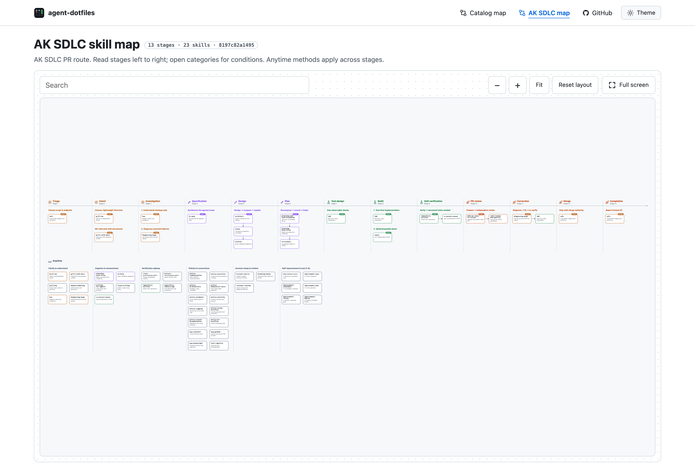

Actual current AK SDLC map. It is a navigation aid; opening it does not run a skill.

**Expected result:** You know which steps run today and which describe the future workflow. This guide does not claim a complete model-driven SDLC run or measured skill improvement.

## 2. Prepare the host and open the installation guide

Use macOS or Linux (including Linux in WSL). Install Git, Python 3.11+ and the agent clients you intend to use. Native Windows is not supported by this installer. Client accounts and credentials remain separate.
Clone https://github.com/hwanjjang/agent-dotfiles and enter the checkout. Open docs/map/workflow.html locally; in Anytime, select account-source, then Sources. Read account/README.md.
The installer supports the default client directories. Resolve custom CODEX_HOME, CLAUDE_CONFIG_DIR or HERMES_HOME layouts before applying changes.

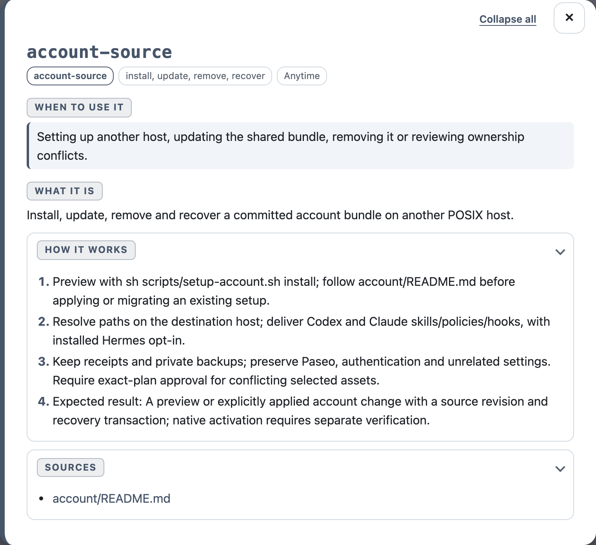

Actual account-source dialog with its trigger, installation guidance and authoritative source link.

**Expected result:** You have a local checkout and compatible tools. You understand that cloning source does not install account settings, clients, model access or credentials.

## 3. Preview before applying the installation

From the checkout run:
sh scripts/setup-account.sh install
Inspect the revision, target paths, conflicts and missing executables. Close affected agent sessions. When the preview matches your intent, run:
sh scripts/setup-account.sh install --apply
For rehearsal, create a separate empty directory outside the checkout and add --home /path/to/disposable-account to both commands. Do not override HOME.
The installer reads a committed revision (HEAD by default), not uncommitted edits. A conflict requires review of an exact saved preview and --approve-plan; never treat it as permission to overwrite personal settings.

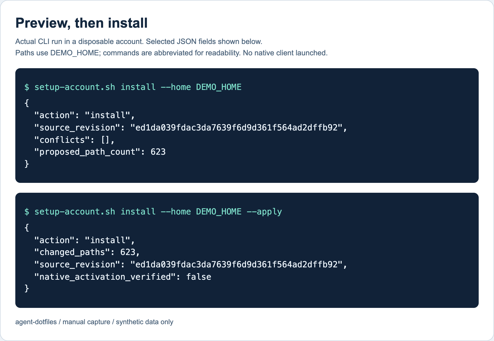

Actual disposable installation, shown as selected JSON output. Paths and command prefixes are shortened for the manual.

**Expected result:** Owned files and configuration fragments are installed with a source revision and recovery transaction. native_activation_verified remains false until separately checked in the client.

## 4. Check delivery, then check native activation

Run sh scripts/setup-account.sh status. Expect installed: true and drift: []. This checks owned files and fragments only.
Next, open your native client in a disposable project. Inspect the available skills and loaded instruction sources. Invoke one small, appropriate skill and verify its observable result. Review or trust Codex hooks through the native client, then exercise selected-plan recovery if you use planning hooks.
MCP discovery and authentication need a separate connection check. Do not enter a token into this guide, a screenshot or a tracked file. This manual did not launch authenticated native clients.

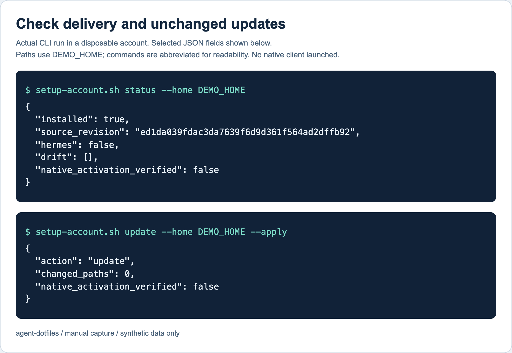

Actual status and unchanged-update output. Clean delivery still reports native_activation_verified: false.

**Expected result:** Keep delivery, skill discovery, instruction following, hook behavior and MCP connectivity as separate checks. A clean receipt does not prove that the agent followed a policy.

## 5. Read the AK SDLC map without overusing it

Open docs/map/workflow.html. For SDLC work, use one entry: "Use sdlc for this request, issue URL or PR URL; finish at pre-merge." State the desired outcome and stopping point. Invocation syntax depends on the client.
SDLC checks current requirements, code, artifacts and dependencies, then starts the earliest unmet prerequisite. The map's stage order is a guide, not a requirement to repeat completed work. Focused skills remain directly usable for small local tasks.
Use + / -, Fit and background drag. Search dims other nodes. Open a node, expand its details and follow Sources; Escape closes the dialog.

Actual map overview. Zoom into a stage to read individual node labels; the overview is for orientation.

**Expected result:** You can choose a method and find its authoritative instructions. The map shows relationships and conditions; it neither grants merge authority nor executes the workflow.

## 6. Run a first task with an observable outcome

For a small local bug: "Fix the parser so empty input returns the documented error. Use TDD, show the failing and passing checks, and stop after local verification." Open tdd in the map for its method.
For an unclear issue: "Use sdlc to establish finishable requirements for this issue; stop at the spec." Investigate code or research first where useful; ask about consequential decisions. Dependent implementation waits for clear requirements.
For a PR: "Use sdlc to review this PR." Existing evidence determines the next action; a URL alone grants no write or merge authority. An implementation request with a pre-merge endpoint includes verification and review. See docs/verification/sdlc-intake.md for bounded native results and limits.

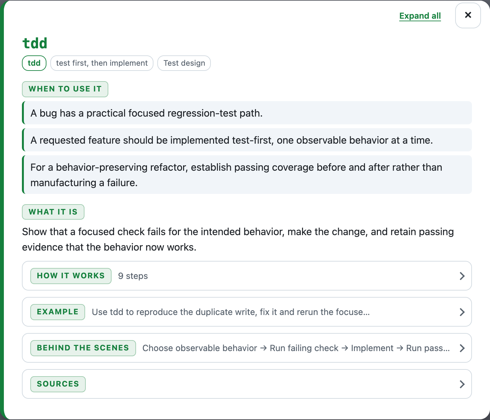

Actual TDD detail dialog. The example request is instructional; it is not a recorded model execution.

**Expected result:** Completion evidence includes the actual change, actual checks and unresolved limits. A claim that tests passed is insufficient without the corresponding execution result.

## 7. Keep longer work resumable

For work spanning sessions, use planning-with-files with one named plan under ignored .planning/: task_plan.md, findings.md and progress.md. Bind concurrent hosts to separate PLAN_ID/PWF_PLAN_ROOT selections or worktrees; a subprocess variable does not bind an already-running host.
On resumption or a consequential scope change, ask sdlc to reassess against the live issue/PR where accessible, checkout, findings and artifact revisions. Reuse valid work and renew affected evidence; preserve task identity, history and iteration counters.
The assessment records outcome/endpoint, evidence, reusable work, open decisions/dependencies, next method and reason, and stopping condition in existing triage/receipts, or inline without lifecycle state. Source: skills/sdlc/references/intake.md.

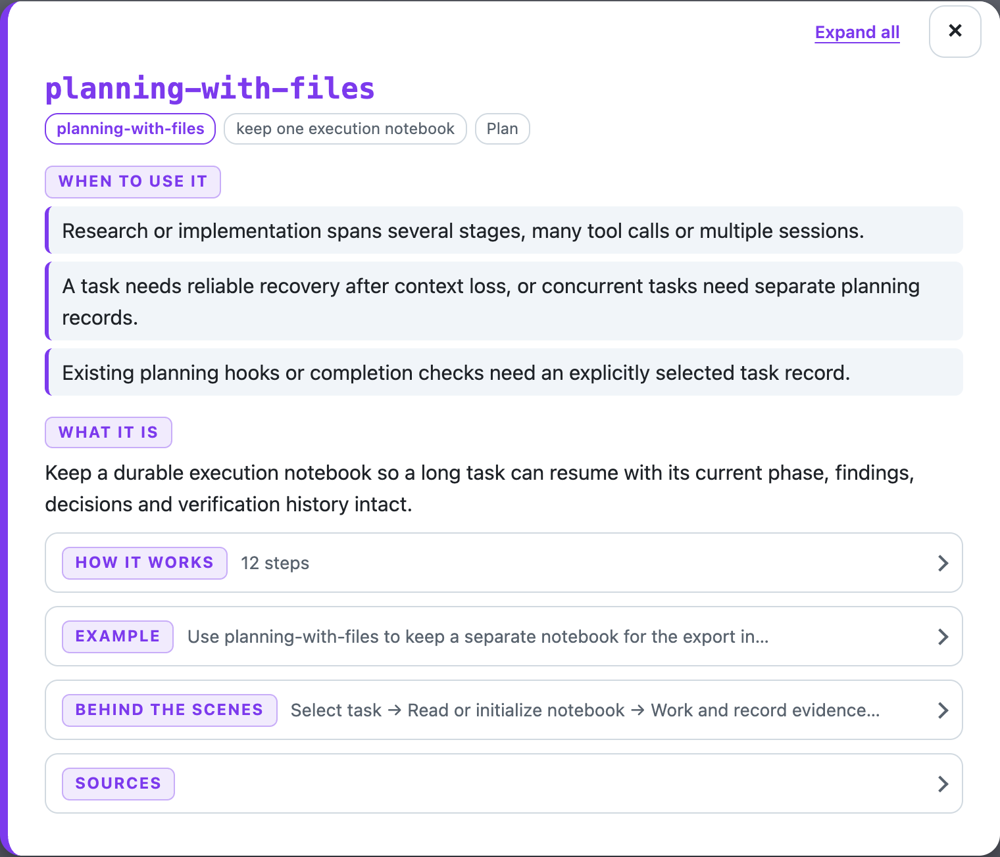

Actual planning-with-files dialog. Native automatic recovery still needs client-specific hook qualification.

**Expected result:** There is one current plan for the task, with honest progress and a clear next action. Planning records remain local; they are not automatically approved public documentation.

## 8. Opt into additional integrations deliberately

Codex and Claude Code are the default delivery targets. For an already-installed Hermes, preview with --with-hermes. Hermes delivery does not add native hooks or MCP integration.
MCP is opt-in. Preview with:
sh scripts/setup-account.sh update --mcp github,context7,playwright
Apply the same selection only after inspection. GitHub is read-only in these templates. Provide GITHUB_MCP_TOKEN and CONTEXT7_API_KEY locally through the client environment, never in tracked JSON.
Planning hook registration can be removed with update --without-hooks --apply. These are planning hooks, not the future observation collector. Omitted selection flags preserve previous choices.

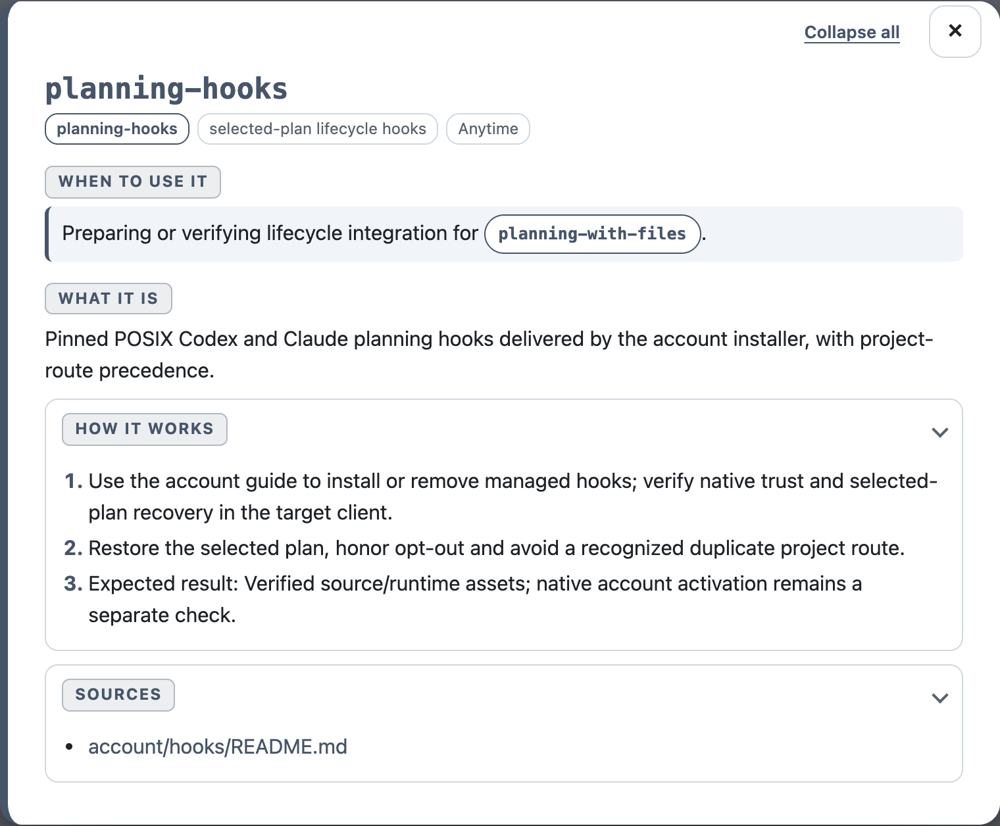

Actual planning-hooks guide in the map. Planning recovery and observation collection are distinct capabilities.

**Expected result:** Only intended integrations are selected. Configuration delivery, executable availability, trust, authentication and task-level effectiveness are verified separately.

## 9. Update, remove or recover safely

Fetch and review a new revision first; the installer never fetches for you. Preview, then apply:
sh scripts/setup-account.sh update --revision origin/main
sh scripts/setup-account.sh update --revision origin/main --apply
Run status afterward. To remove owned installation content, preview uninstall and then add --apply. Personal settings and unowned assets are preserved.
For a recorded transaction, preview rollback --transaction TRANSACTION_ID, then add --apply. Roll back newest transactions first. Later edits can block rollback; inspect the conflict instead of forcing deletion. Keep receipts and backups private.

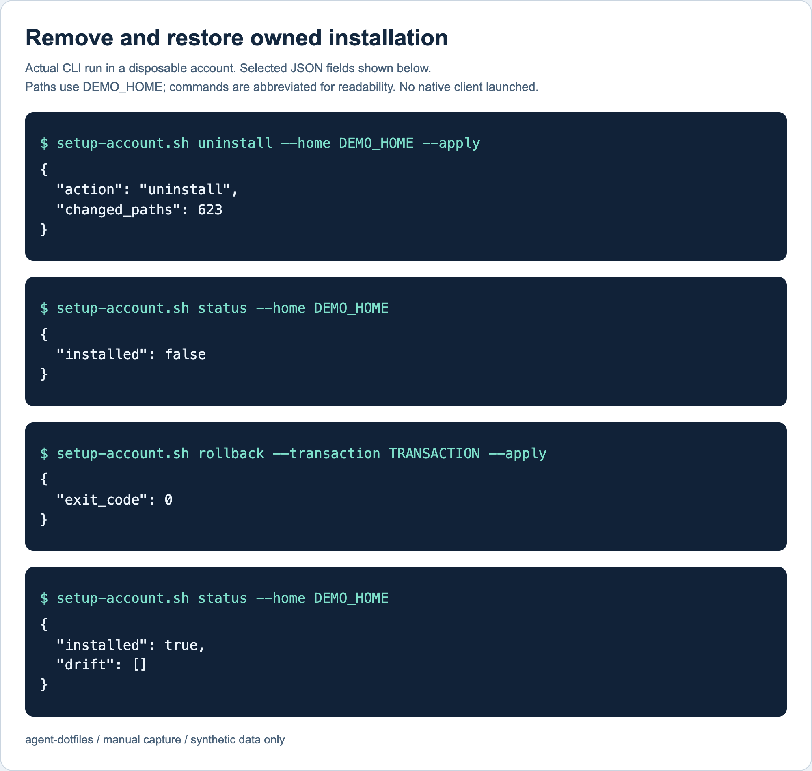

Actual disposable uninstall followed by guarded rollback. The installation is restored with no drift.

**Expected result:** The delivered revision and owned state match your intent. Uninstall does not erase native session logs or observation data; revoke observation registrations separately.

## 10. Understand the self-improving loop

In Anytime, open Self-improvement & eval (1-6). Its numbered cycle is: observe, reproduce a case, prepare a candidate, compare through eval, review, deploy, then observe again. This is separate from the 13-stage PR route. Open each node for its status and source.
The existing installer owns deployment and rollback. The observation store must never rewrite installed skills or installer state. Collection permission is not permission to send evidence to a remote model or publish it.
Today only the synthetic observation store is implemented from this loop. Native collection, task binding, triage, model comparison and promotion orchestration are planned. Analysis and paid evaluation are designed to start manually.

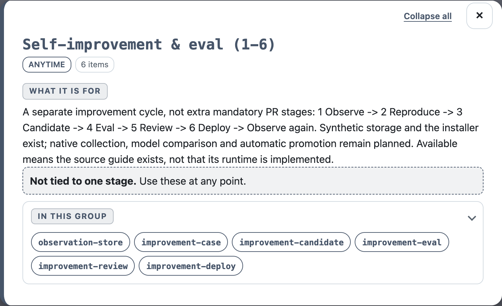

Actual Self-improvement & eval group in the updated map. The guide is available; several described runtime capabilities are still planned.

**Expected result:** You can identify who records, who proposes, who evaluates and who deploys. Improvement requires evidence; it is not an agent silently rewriting its own instructions.

## 11. Try synthetic observations in a disposable account

This requires the candidate checkout containing scripts/improvement/observations.py, plus Python 3.11+. Run the included demo-observations.py with --repo /path/to/checkout. It creates and deletes its own disposable home; it does not activate native collection.
For manual use, give observations.py an explicit --home. grant binds --project, --profile, --source and --start-after. Use the returned registration_id and epoch with capture; supply bounded synthetic JSON on stdin. events reads accepted metadata.
A stable source ID deduplicates retries. Missing IDs retain possible-duplicate uncertainty. response_end is not task success. The environment manifest is unknown in this adapter.

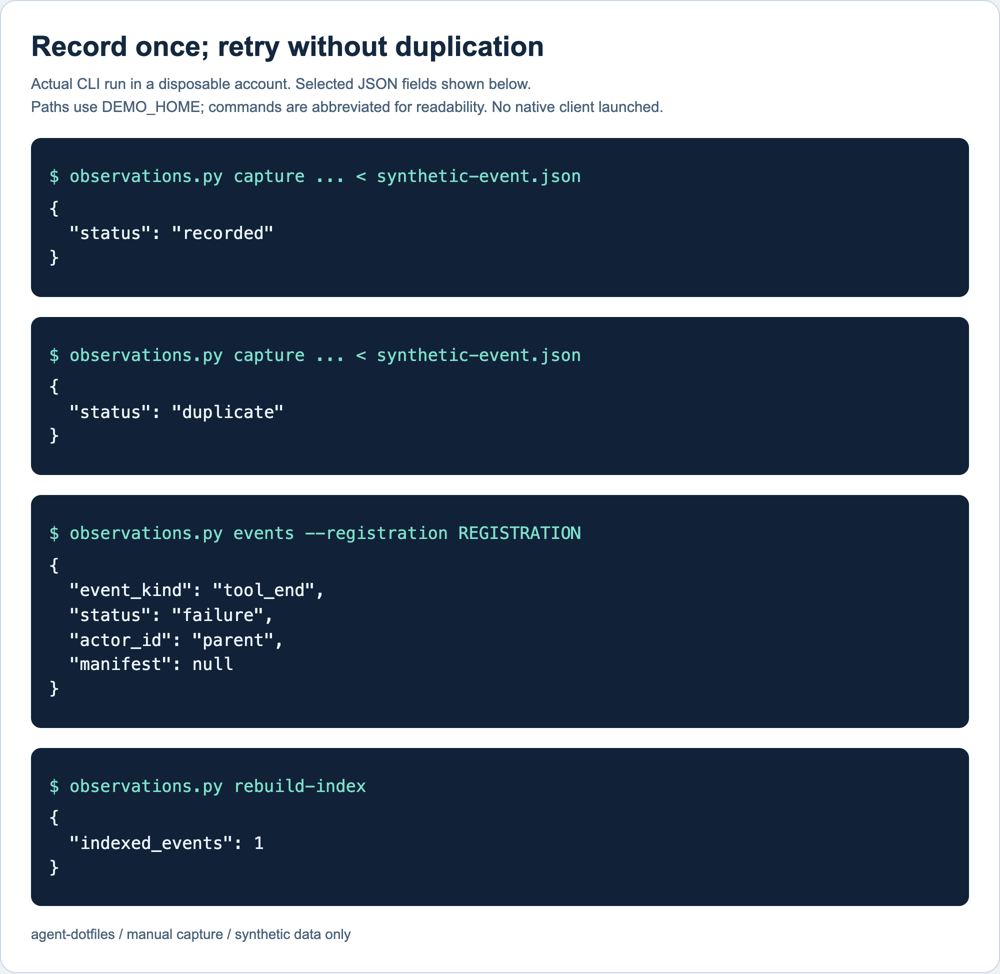

Actual synthetic capture, retry, read and index results. No skill exposure or task success is inferred from the failed tool event.

**Expected result:** One event remains after an exact retry, and excluded output text is absent. events is the consent-aware read path; index.sqlite is a rebuildable cache, not the authority.

## 12. Control the scope, retention and deletion of records

The private root is <selected-home>/.agents/agent-dotfiles/observations/. Grants bind exact project/profile/source registrations. There is no recursive account-history scan. Prompts, tool arguments, output and transcript bodies are excluded; allowed ID fields must contain opaque identifiers, not secrets.
Use revoke --registration ID to disable and purge one registration. Revoke every registration to forget a project. Old-epoch work stays disabled. Regrant requires a new epoch and a declared source high-water mark.
Grants expire within 30 days. Run prune for physical cleanup; no scheduler is installed. If deletion is interrupted, reads remain disabled and revoke/prune can finish it. Native originals and backups have separate owners.

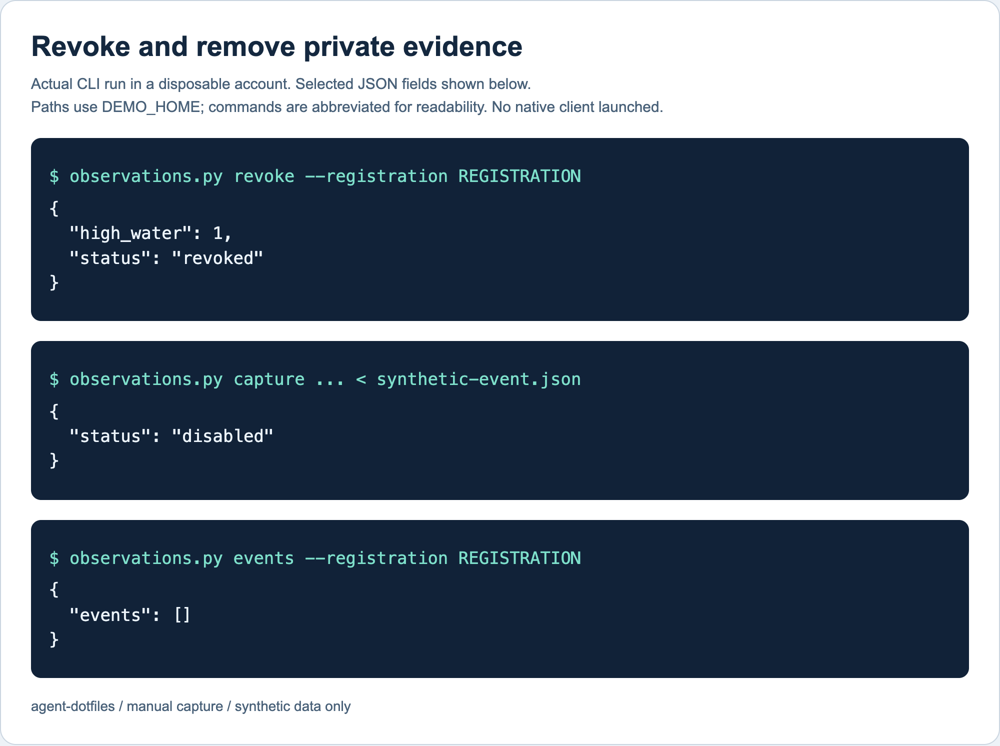

Actual revoke, disabled old-epoch capture and empty consent-aware read after deletion.

**Expected result:** You can stop collection and remove owned evidence. Before remote triage or judging, approve the exact input, destination, purpose and budget separately. Never publish raw histories or backups.

## 13. Turn a symptom into a reviewed case

Worked example (hypothetical, not a measured defect in an installed skill): a test command fails to start, but the assistant says verification passed. A failed command alone does not prove a false claim; retain approved evidence of the claim or mark the finding insufficient.
Create a synthetic reproduction without personal paths or credentials. Define an observable outcome: report that verification is blocked, explain the cause and avoid a false pass. Add a genuine passing case, a near-miss where no test is requested, and an unavailable-tool case. Include English and Korean prompts.
Keep development examples separate from evaluator-owned holdouts. The updater must not see holdout inputs or hidden answers.

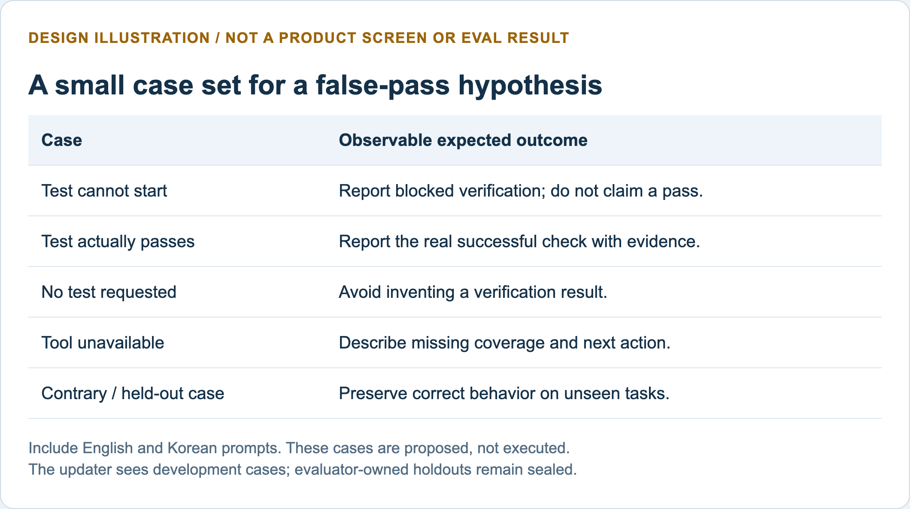

Illustrative case checklist for future evaluation. These are proposed scenarios, not results from model trials.

**Expected result:** The case states input, expected outcome, relevant process constraints and evidence. User feedback is a lead, not a proven diagnosis of the skill.

## 14. Make one minimal skill candidate

Inspect whether the failure comes from infrastructure, a missing tool, ambiguous instructions, incorrect routing or the skill itself. A deterministic defect may need a script or check instead of more prose.
For the hypothetical false-pass case, a candidate instruction might say: "Only report a check as passed when its recorded execution succeeded; distinguish failed, blocked and unrun checks." Inspect existing instructions first; do not add a duplicate rule already present.
Use writing-for-agents and the host skill-creator contract when editing the actual skill. Record the baseline, minimal diff, hypothesis and dependency closure. The candidate must not change the grader, fixture or expected answer during the comparison.

Actual TDD guidance used as a method reference. The candidate wording above is an example, not an applied repository change.

**Expected result:** You have a small, reviewable hypothesis and a fixed candidate identity. Removing redundant instructions can also be an improvement; longer skills are not automatically better.

## 15. Freeze the comparison before running it

Open improvement-eval (step 4) in the map. The comparative runner is not implemented yet. Use the included eval-plan.example.json as a planning worksheet, not an executable command.
Freeze the cases, current/candidate hashes, runner and grader identities, actual model/provider/settings, environment, budget and acceptance rule. Use fresh isolated state per trial and vary arm order. A separate worktree alone does not block access to account history or hidden answers.
Test organic routing with a competing catalog and no forced skill name. Keep forced behavior tests separate. A small pilot of 6-10 cases with 3 repeats per arm can expose defects; it does not prove statistical superiority. Preserve failed, blocked and inconclusive runs, not just successful ones.

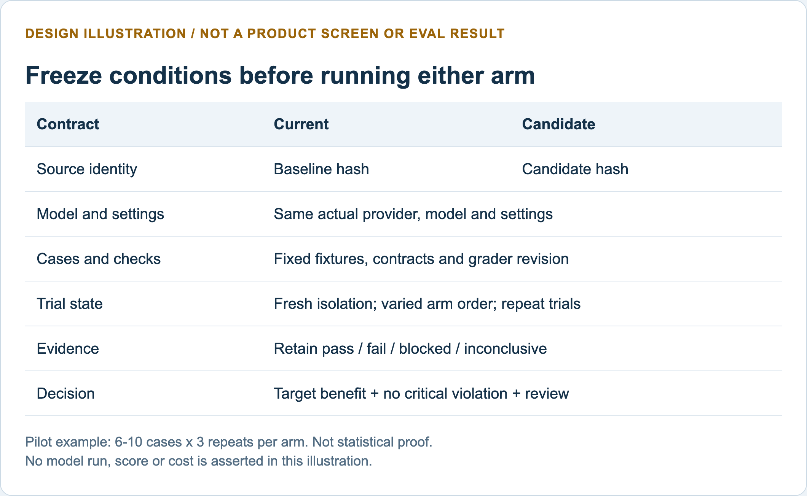

Illustrative frozen experiment plan. No actual model execution, token spend or score is represented.

**Expected result:** Both versions face comparable conditions. A changed candidate, grader, fixture or relevant environment invalidates the corresponding result. Unclear evidence keeps the current version.

## 16. Validate the graders before trusting the scores

Prefer deterministic checks of real artifacts and command results. Score task outcome, required process and observed skill exposure separately. Passing a storage unit test does not establish better skill behavior.
For subjective judgments, calibrate a blinded model judge against known-good, subtle-bad, false-success, missing-evidence and injection cases. Give it no tool or filesystem access to hidden answers. A judge unable to distinguish these examples is not qualified to approve a candidate.
For MCP, separate static config validity, synthetic tool contracts and task success with the real service. Infrastructure failures and unavailable evidence must not become passes. Repeated feedback can leak holdouts; limit exposure and rotate them.

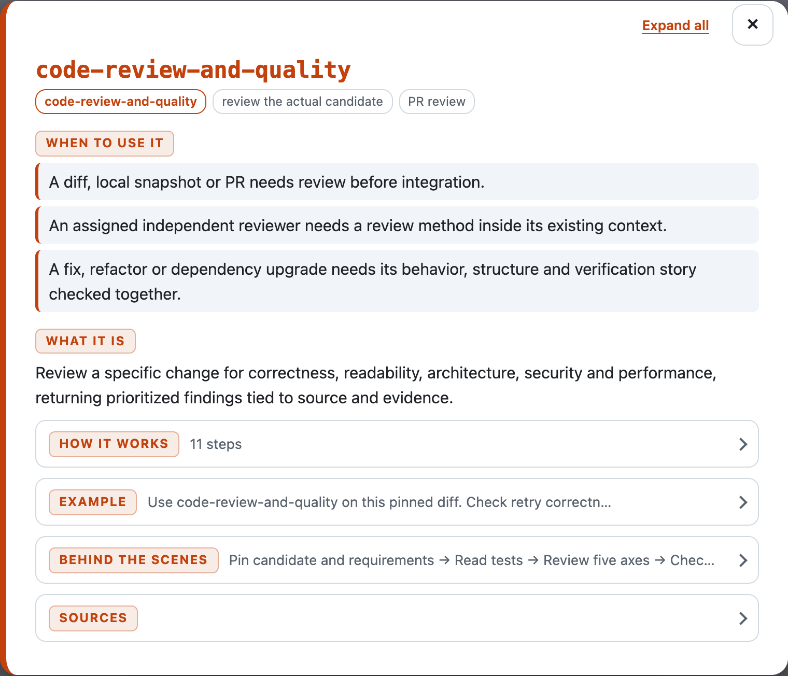

Actual code-review-and-quality dialog. It is a review reference, not a built-in model-eval screen.

**Expected result:** You can explain why a result passed, failed, was blocked or stayed inconclusive. A high aggregate score cannot compensate for a critical policy violation.

## 17. Promote the tested version and keep recovery possible

Before the experiment, define the target benefit, regression limits and acceptable cost. Require improvement on the target, no observed critical violation, qualified holdout evidence and independent review. If the result is unclear, retain the current version.
Review the exact source diff and sanitized report. After an authorized commit/merge, use the existing installer to preview and apply that committed revision. Verify delivered hashes match the tested candidate, then check native discovery and affected behavior.
Observe regressions after deployment, but account for task/model/tool differences before attributing them to a skill. Reproduce the signal under a fixed comparison. Use guarded rollback when appropriate; do not delete observation evidence as part of installer recovery.

Actual installer recovery example reused as an operational reference. Automated eval-to-promotion integration is still planned.

**Expected result:** Only a reviewed, tested source identity is delivered. Observation, model inference, public publication, merge and account activation retain their own scope and authority.

## 18. Troubleshoot and find the authoritative source

Skill missing: check the delivered revision, native skill list, duplicate installations and project overrides. Hook quiet: inspect trust, selected plan and client coverage. MCP unavailable: check executable and required environment variables without exposing them.
No observations: expected for ordinary sessions today; the CLI only accepts synthetic input. disabled means missing, expired or revoked consent. rejected means invalid scope/schema/identity; busy means retry later. After corruption, revoke may require a new source generation.
Use account/README.md, account/observation/README.md, docs/map/workflow.md and docs/decisions/account-improvement-loop.md as the current authorities. The source bundle includes bilingual editable text, screenshots, a disposable demo and non-executable eval worksheets.

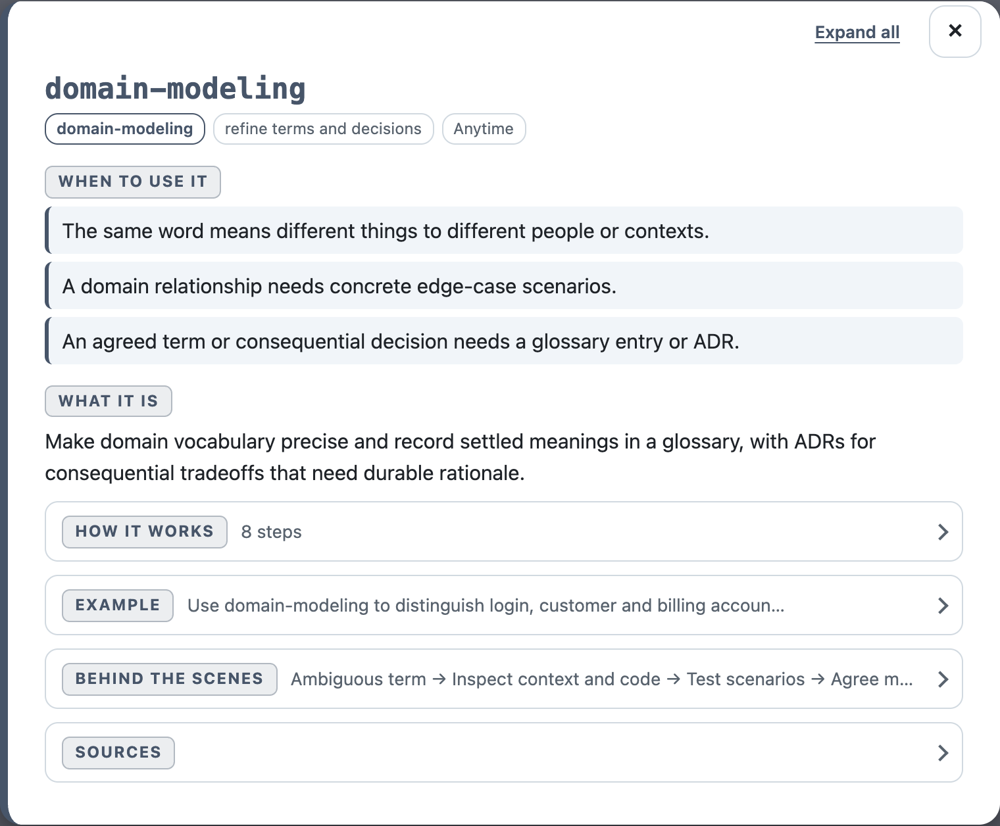

Actual Anytime search example: glossary opens domain-modeling. Use the same navigation pattern to find a relevant guide.

**Expected result:** You diagnose the correct layer instead of assuming a skill failed. Capture facts and verification gaps, sanitize shareable evidence and return to the appropriate source or workflow stage.
